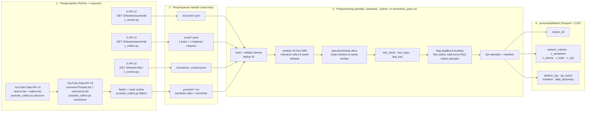

# Pipeline Data X + YouTube: Kasus Keracunan MBG (Sukoharjo 2025 vs Karo 2026)

Kode pengumpulan dan preprocessing data untuk penelitian *Pergeseran Narasi Publik terhadap Program Makan Bergizi
Gratis (MBG)* (TK Analitika Media Sosial, Fasilkom UI). Pipeline mengambil unggahan X dan komentar YouTube tentang
dua kasus keracunan MBG, lalu mengubahnya menjadi korpus siap analisis untuk tiga pertanyaan penelitian:

- **RQ1**: tema, sentimen (emosi), dan sikap (stance) terhadap keberlanjutan program, Sukoharjo vs Karo.
- **RQ2**: atribusi tanggung jawab dan tuntutan publik, termasuk sebelum/sesudah laporan dampak kesehatan Karo.
- **RQ3**: perbedaan karakter diskusi X vs YouTube.

> **Data tidak ada di repo ini.** Isi post/komentar, ID akun, dan nama korban (anak di bawah umur) tidak boleh
> dipublikasikan, dan ketentuan X & YouTube tidak mengizinkan redistribusi konten mentah. Repo hanya berisi kode,
> konfigurasi, test dengan data sintetis, dan dokumentasi. Lihat [Data & etika](#data--etika).

---

## Alur end-to-end



---

## Struktur repo

```
config/                 pipeline.yaml (semua konstanta), aturan relevansi, kata kunci RQ2, kamus slang, stopword
src/anmedsos_prep/      paket preprocessing (load, scope, text, dedup, quality, features, corpus, qa, cli)
tests/                  pytest + proyek mini sintetis (tanpa data asli)
notebooks/eda_qa.ipynb  EDA, hanya membaca processed/latest/
x/                      collector X: x_counts.py, x_collect.py, x_context.py, x_verify.py, x_inspect.py, x_pilot.py
                        + LOG_PENGUMPULAN_X.md (perintah & versi skrip yang benar-benar dijalankan)
youtube/               collector YouTube (dipakai untuk kedua kasus): youtube_collect.py, make_candidates_all.py
preprocessing_plan.md                  rencana, temuan profiling data, keputusan D2-D17, keterbatasan
```

---

## 1. Pengumpulan data

Butuh kredensial sendiri. Simpan sebagai environment variable, **jangan** ditulis ke file atau di-commit.

```powershell
$env:X_BEARER_TOKEN = "..."     # X API (akses full-archive search, pay-per-use)
$env:YT_API_KEY = "..."         # YouTube Data API v3
$env:HASH_SALT = "..."          # salt rahasia tim untuk pseudonimisasi
```

### X (jalankan dari folder `x/`)

| Langkah | Perintah | Endpoint | Catatan |
|---|---|---|---|
| Volume per hari | `python x_counts.py` | `GET /2/tweets/counts/all` | Ditagih per request; dipakai untuk menentukan batas per segmen dan menghitung bobot cakupan |
| Tarik post | `python x_collect.py --only XS1,XK1b` | `GET /2/tweets/search/all` | Window 45 hari dibagi 5 segmen × 9 hari; batas post per segmen; `max_results` ≤ 500; pagination `next_token`; 429 → tunggu 60 detik; error lain → berhenti agar saldo tidak terbuang; tanpa expansions |
| Segmen padat | `python x_collect.py --only XS1 --days 0-2 --tag S1a --cap 80` | sama | Hasil X urut dari terbaru, jadi segmen yang mentok dipecah per hari |
| Konteks reply/quote | `python x_context.py` | `GET /2/tweets?ids=` | Hanya ID induk/kutipan yang belum ada di `raw/`, maks. 100 ID per request |
| Verifikasi | `python x_verify.py XS1 XS2` | (offline) | Bandingkan post terambil vs counts per hari |
| Uji kueri | `python x_pilot.py` | `GET /2/tweets/search/all` | Pilot 30 post per kueri; hasilnya tidak dipakai di data akhir |

Kueri (semua `-is:retweet`): XS1 lokasi Sukoharjo + istilah program, XS2 ayam kurang matang + program,
XK1b lokasi Karo + istilah program, XK2b nama korban/RSCM + istilah kasus. XS3/XK3 (gejala generik) hanya diambil
counts-nya. Definisi lengkap ada di `x/x_collect.py`. Setiap respons disimpan utuh sebagai satu baris JSONL di
`x/raw/x_<kasus>_<kueri>_<segmen>.jsonl`. Urutan perintah, opsi, dan versi skrip yang dipakai untuk tiap file
tercatat di [x/LOG_PENGUMPULAN_X.md](x/LOG_PENGUMPULAN_X.md).

### YouTube

Script menulis ke `raw/` dan `interim/` di folder tempat ia dijalankan, jadi jalankan dari folder data tiap kasus
(Sukoharjo: `youtube/sukoharjo/`). Kueri YS1–YS4 (Sukoharjo) dan YK1–YK7 (Karo) ada di `youtube/youtube_collect.py`.

```powershell
cd youtube\sukoharjo
python ..\youtube_collect.py discover --dry-run      # rencana kuota
python ..\youtube_collect.py discover                # search.list + videos.list per kueri x segmen -> interim/yt_candidates.csv
# (tim memberi label relevan=y/n di yt_candidates.csv untuk memilih video yang ditarik komentarnya)
python ..\youtube_collect.py comments --max-pages 5  # commentThreads.list (100 thread/halaman) + comments.list untuk reply
python ..\youtube_collect.py flatten                 # -> interim/yt_comments.csv, author di-hash (butuh HASH_SALT)
```

Kuota dihitung sendiri oleh script dan berhenti di `--quota-limit` (default 6.000 dari 10.000 unit/hari).
Komentar ditarik dengan urutan `relevance`, maks. 5 halaman per video (500 thread) dan semua reply, untuk video
dengan ≥ 5 komentar. Video yang file raw-nya sudah ada dilewati (`--force` untuk menimpa).

**Scrape ulang Karo (2026-10-27).** Supaya relevansi tidak bergantung pada label manual, komentar **semua** kandidat
Karo ditarik, lalu relevansi ditentukan aturan judul di preprocessing:

```powershell
python ..\make_candidates_all.py                     # salinan kandidat dengan relevan=y untuk semua video
python ..\youtube_collect.py --candidates interim/yt_candidates_all.csv comments
python ..\youtube_collect.py flatten --comments-csv interim/yt_comments_all.csv
```

Riwayat tarik YouTube: Sukoharjo 20–22 Oktober 2026 (log: `interim/yt_collection_log.csv`); Karo batch awal
2026-10-21 dan batch scrape ulang 2026-10-27 (terlihat di kolom `collected_at`).

---

## 2. Preprocessing

### Setup (sekali)

```powershell
python -m venv .venv
.\.venv\Scripts\Activate.ps1
pip install -r requirements.lock
pip install -e .
nbstripout --install --attributes .gitattributes   # output notebook tidak ikut ter-commit
copy config\victim_names.example.txt config\victim_names.txt   # lalu isi pola nama korban (tidak di-commit)
```

### Letakkan data mentah

Path diatur di `config/pipeline.yaml` (`paths`). Defaultnya:

```
x/raw/*.jsonl  x/counts/*.json  x/context/x_context.jsonl
youtube/yt_candidates.csv  youtube/yt_comments_all.csv                       (Karo)
youtube/sukoharjo/interim/yt_candidates.csv  .../yt_comments.csv             (Sukoharjo)
```

### Jalankan

```powershell
$env:HASH_SALT = "..."                       # wajib; pipeline berhenti bila kosong
pytest                                       # 42 test, data sintetis
python -m anmedsos_prep check                # konstanta config == konstanta collector
python -m anmedsos_prep run                  # -> processed/<run_id>/ dan processed/latest/
```

Atau sekaligus: `.\run.ps1`. Run penuh butuh sekitar 1 menit. Input dan config yang sama menghasilkan output yang
identik byte per byte (kecuali `manifest.json`, yang memuat waktu run). Hal ini diuji di `tests/test_pipeline.py`.

### Apa yang dilakukan pipeline

| Tahap | Isi | Modul |
|---|---|---|
| Load & validasi | Nama file X harus sesuai pola; ID dibaca sebagai string; reply YouTube tanpa induk, video tak dikenal, dan ID duplikat ⇒ error | `load_x`, `load_youtube` |
| Dedup ID | Satu baris per tweet (gabungan kueri, metrik dari file terbaru) | `dedup` |
| Window | 45 hari sejak insiden (WIB); flag `in_window` collector YouTube wajib sama | `scope.add_time` |
| Relevansi video | Aturan judul yang sama untuk kedua kasus: `inti`, `inti_hari_awal`, `sub_kontroversi`, `tidak` (`config/relevance_rules.yaml`) | `scope.video_relevance` |
| Relevansi tweet | `keyword_case`, `incident_early` (XS2, hari 0–8), `rscm_late` (XK2b), `thread_context`, `ambiguous`, `none` | `scope.text_relevance` |
| Privasi | `author_id` X → `sha256(salt+id)[:16]`; mention → `@user`; nama korban → `[KORBAN]` | `pseudonymize`, `text` |
| Teks | `text_clean` (NFKC, zero-width, URL, mention, timestamp video; emoji & tanda baca tetap), `text_topic` (slang, stopword dengan negasi dipertahankan, stem Sastrawi), `dup_key` | `text` |
| Flag | duplikat lintas akun, self-repeat, copypasta, share judul berita, emoji-only, low-content, spam, akun hiperaktif | `dedup`, `quality` |
| Fitur | segmen S1–S5, fase, sebelum/sesudah laporan kesehatan, kata kunci RQ2, engagement persentil, bobot cakupan X, sampel topik ≤ 200/video, fitur kedalaman argumentasi | `features` |
| View | `v_volume` ⊃ `v_sentiment` ⊃ `v_stance` ⊃ `v_topic`, `v_rq2` | `corpus` |
| QA | Run gagal bila: `doc_id` ganda, di luar window, ID akun asli, mention/nama korban tersisa, sel kasus × platform kosong, attrition tidak rekonsiliasi, daftar video kena batas berubah, konstanta beda dengan collector | `qa` |

### Output (`processed/latest/`)

| File | Isi |
|---|---|
| `corpus_all.parquet` / `.csv` | semua dokumen in-window non-kosong + semua flag (kamus: `data_dictionary.md`) |
| `views/v_*.parquet` | subset siap pakai per analisis, + `video_weight` untuk proporsi makro per video |
| `x_clean.parquet`, `yt_clean.parquet` | korpus per platform |
| `attrition_log.csv` | jumlah baris sebelum/sesudah tiap tahap per platform × kasus |
| `qa_report.md` | status QA, volume per segmen/fase, cakupan, dominasi video, distribusi relevansi, contoh transformasi teks |
| `video_relevance.csv` | tingkat relevansi tiap video kandidat + pola aturan yang cocok (judul dimask) |
| `coverage_x*.csv` | cakupan X per kueri × hari vs counts |
| `emoji_only.csv` | komentar tanpa huruf (sinyal sentimen) |
| `manifest.json` | sha256 tiap file input, versi library, commit git, fingerprint salt (bukan salt-nya), isi config |

### Memakai view & analisis sensitivitas

```python
import pandas as pd
from anmedsos_prep.config import load_config
from anmedsos_prep.corpus import view

cfg = load_config("config/pipeline.yaml")
c = pd.read_parquet("processed/latest/corpus_all.parquet")
stance = view(c, "v_stance", cfg)                          # analisis utama
no_cap = view(c, "v_stance", cfg, exclude_capped=True)     # D12: tanpa 13 video yang kena batas 500 thread
with_sub = view(c, "v_stance", cfg, include_sub=True)      # D14: + sub-kontroversi (Karo saja)
ctx = view(c, "v_stance", cfg, require_context=True)       # D16: reply/quote X yang konteksnya tersedia
```

---

## Data & etika

- **Hanya konten publik.** Post X publik lewat API resmi; komentar YouTube publik lewat YouTube Data API.
  Tidak ada scraping, login, atau akses akun privat.
- **Minimalisasi data.** X: tanpa data profil akun dan tanpa expansions. YouTube: respons mentah (hanya di laptop
  tim) memuat nama tampilan, tetapi `flatten` hanya meneruskan hash `authorChannelId` ke CSV. Pipeline preprocessing
  membuang `author_id` X setelah di-hash.
- **Pseudonimisasi.** ID akun diganti `sha256(salt + id)[:16]`. Salt hanya ada di environment variable anggota tim;
  manifest hanya mencatat sidik jari `sha256(salt)[:8]`.
- **Perlindungan anak.** Nama korban (siswi di bawah umur) dimask `[KORBAN]` di semua teks dan judul video pada output.
  Pola namanya ada di `config/victim_names.txt`, yang tidak di-commit.
- **Tidak ada redistribusi.** Data mentah dan `processed/` dikecualikan lewat `.gitignore`. Untuk replikasi, data
  ditarik ulang dengan kredensial sendiri memakai collector di atas. Post yang sudah dihapus tidak akan ikut.

Keputusan desain (D2–D17), temuan kualitas data, dan keterbatasan lengkap ada di
[preprocessing_plan.md](preprocessing_plan.md).
