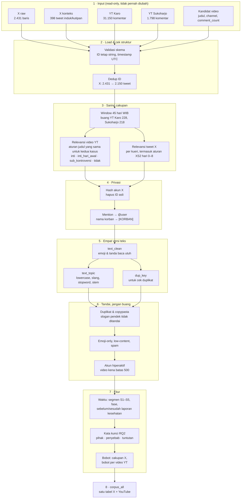
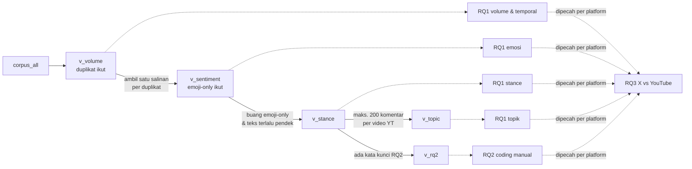

# Rencana Preprocessing & Cleaning Data X + YouTube (Kasus Keracunan MBG)

> Status: **diimplementasi 2026-10-28** di `src/anmedsos_prep/` (cara pakai: `README.md`). Disusun 2026-10-28.
> Semua angka di dokumen ini diprofil langsung dari `x/raw/`, `x/counts/`, `youtube/yt_comments_all.csv`,
> `youtube/yt_candidates.csv`, `youtube/sukoharjo/interim/*.csv`, dan `relabel_suggestion_n_videos.csv` (cek judul untuk profiling).
> Window yang dipakai: **45 hari sejak insiden (WIB)**, 5 segmen × 9 hari.

**Tujuan:** menghasilkan korpus X + YouTube yang siap untuk RQ1–RQ3 lewat pipeline deterministik
(input sama + config sama ⇒ output identik byte-per-byte). Setiap baris yang dibuang tercatat alasannya, dan setiap analisis
tahu persis versi teks dan subset mana yang dipakainya.

---

## Ringkasan visual (baca ini dulu)

### Alur pipeline



### Dari korpus ke analisis

Semua filter terjadi di satu tempat. Setiap analisis memakai "view" yang berbeda:



### Status singkat

| | |
|---|---|
| ✅ Data | Lengkap, tidak ada yang perlu ditarik lagi |
| ✅ Keputusan | D2–D17 sudah diputuskan (§3) |
| ✅ Pipeline | Diimplementasi (`python -m anmedsos_prep run`), 42 test lulus, QA lulus, output deterministik |
| ✅ Aturan relevansi | `config/relevance_rules.yaml`, diterapkan identik ke kedua kasus (Task 3.2, 3.3) |
| ✅ Langkah manual | Dihapus semua (D17): tidak ada labeling, validasi manual, atau sampel anotasi |
| ⚠️ Privasi | `x/raw/` dan `x/context/` masih berisi ID akun & nama korban, jangan dibagikan |

Bagian lain di bawah adalah detail. Bila hanya butuh garis besar, cukup baca bagian ini dan §3 (keputusan).

---

## 1. Keselarasan dengan proposal (`TK1_KCSA.docx`) setelah window 45 hari

### 1.1 Kebutuhan analisis → kebutuhan data

| RQ / teknik di proposal | Input yang dibutuhkan dari pipeline | Subset (§6) |
|---|---|---|
| RQ1 topic modeling | `text_topic` (dinormalisasi) + `text_clean` untuk embedding | relevan, `dup_keep`, bukan noise |
| RQ1 stance terhadap keberlanjutan program (mendukung / menolak / mendukung bersyarat) | `text_clean` + konteks (judul video / teks yang dibalas bila ada) | relevan, `dup_keep` |
| RQ1 sentimen sebagai emosi (marah, takut, kecewa, simpati) | `text_clean` dengan emoji, kapital, tanda baca utuh | relevan, termasuk emoji-only |
| RQ1 volume & intensitas temporal "selama 45 hari" | semua dokumen relevan + `coverage_weight` (X) + flag cap (YT) | relevan, **termasuk** duplikat |
| RQ2 saring kata kunci → coding manual sampel | `kw_*` flags + sampel berstrata reproducible | relevan, `dup_keep`, `any_kw_rq2` |
| RQ2 sebelum vs sesudah laporan dampak kesehatan (Karo, 2026-09-08 = hari ke-26) | `days_since_health_report`, `after_health_report` | Karo saja |
| RQ3 X vs YouTube (topik, sentimen, sikap, kedalaman argumentasi) | semua kolom di atas dipecah per platform + fitur kedalaman (Task 7.6, ⏳ D10) | sama dengan RQ1/RQ2 |

### 1.2 Kenapa 45 hari (bahan justifikasi di §1.6.2)

Laporan dampak kesehatan Karo (hilang ingatan) muncul hari ke-26. Dengan window 30 hari, periode "sesudah laporan"
hanya 4 hari (hari 26–29), padahal diskusi justru memuncak di sana dan terus berlanjut:

| | Hari 0–25 | Hari 26–29 | Hari 30–44 (hilang bila 30 hari) |
|---|---:|---:|---:|
| X Karo (tweet unik) | 742 | 513 | 341 |
| YouTube Karo (komentar, semua video) | 10.382 | 10.950 | 9.590 |

Window 45 hari memberi 19 hari sesudah laporan, cukup untuk melihat apakah pergeseran ke atribusi tanggung jawab dan
kompensasi bertahan atau hanya lonjakan sesaat. Window yang sama diterapkan ke Sukoharjo.

### 1.3 Revisi teks proposal yang diperlukan

| Bagian | Sekarang | Revisi |
|---|---|---|
| Judul | "...Januari 2025 dan **September** 2026" | "...Januari 2025 dan **Agustus** 2026" (insiden 13 Agu 2026) |
| §1.6.2 | "rentang **30 hari** ... (16 Januari–15 Februari 2025; 13 Agustus–12 September 2026)" | "**45 hari** ... (16 Januari–1 Maret 2025; 13 Agustus–26 September 2026)", tambah alasan §1.2 |
| §1.6.2 | "video YouTube beserta judul **dan deskripsi**" | "beserta judul" (D8) |
| §1.6.2 | "unggahan X, reply, dan quote" | tambahkan: retweet tidak diambil (`-is:retweet`); jumlah retweet tetap dipakai sebagai metrik engagement |
| §1.6.4 | "perubahan intensitasnya selama **30 hari**" | "selama **45 hari** (5 segmen × 9 hari)" |
| §1.3 & §1.4 | "sekitar tiga minggu setelah insiden" | laporan muncul hari ke-26 (8 September 2026), hampir empat minggu |
| §1.6.4 RQ1 | (belum ada) | sebutkan unit analisis: satu tweet / satu komentar; relevansi video ditentukan aturan judul yang sama untuk kedua kasus |

---

## 2. Inventaris & temuan data

Tingkat: 🔴 memblokir / mengubah hasil · 🟠 wajib ditangani pipeline · 🟡 cukup ditandai & didokumentasikan

### 2.1 Inventaris

| Sumber | File | Isi | Dipakai sebagai |
|---|---|---|---|
| X raw | `x/raw/x_{kasus}_{qid}_{slice}.jsonl` | 143 file (35 kosong), 250 halaman, 2.431 baris → **2.150 tweet unik** (Karo 1.596, Sukoharjo 554) | raw immutable |
| X counts | `x/counts/{qid}.json` | volume per hari UTC dari `counts/all`, termasuk XS3/XK3 | konteks volume & bobot cakupan |
| X pilot | `x/pilot_x/` | uji kueri awal | **tidak dipakai** (D4) |
| YT Karo, kandidat | `youtube/yt_candidates.csv` | 591 video (323 `y`, 268 `n`); `sub_event` kosong di semua 268 video `n` | metadata video |
| YT Karo, komentar | **`youtube/yt_comments_all.csv`** | **31.150** komentar (26.509 top-level, 4.641 reply) dari **326 video**; mencakup 100% komentar `yt_comments.csv` lama | raw immutable |
| YT Karo, komentar lama | `youtube/yt_comments.csv` | 12.981 komentar, salt berbeda | **tidak dipakai** (diganti file `_all`) |
| YT Karo, review label | `youtube/yt_label_review.csv` | 256 video, `label_otomatis` | referensi saja |
| YT Sukoharjo, kandidat | `youtube/sukoharjo/interim/yt_candidates.csv` | 304 video (139 `y`, 165 `n`); `channel_type`/`sub_event` kosong semua | metadata video |
| YT Sukoharjo, komentar | `youtube/sukoharjo/interim/yt_comments.csv` | 1.798 komentar dari 83 video (video `y` saja) | raw immutable |
| YT Sukoharjo, log | `youtube/sukoharjo/interim/yt_collection_log.csv` | log search + tarik komentar | cek silang |
| Cek judul | `relabel_suggestion_n_videos.csv` | 433 video `n` dengan kategori `inti` / `sub_*` / `abu` / `tidak` | profiling & dasar keputusan D11 saja; **tidak dibaca pipeline** |

### 2.2 YouTube Karo (`yt_comments_all.csv`)

| # | Tingkat | Temuan | Bukti / angka |
|---|---|---|---|
| Y-ALL | 🟡 | Dua batch tarik: `collected_at` 2026-10-21 (12.981, batch awal) dan 2026-10-27 (18.169, video `n`). `like_count` adalah snapshot di umur berbeda. | `collected_at` |
| Y-CAP | 🔴 | **13 video kena batas 500 thread top-level** (`--max-pages 5` × 100). `comment_count` total 16.254, terambil 8.358, jadi ±7.900 komentar hilang. 10 dari 13 video terbit 5–20 September, tepat di sekitar laporan kesehatan, sehingga **periode "sesudah" RQ2 kurang terwakili**. Urutan tarik `relevance` berarti yang hilang adalah komentar yang kurang disukai/kurang dibalas, bukan acak. | `UmxQ8J2e8mA` (3.439 → 949), `__bNKP6EZek` (1.750 → 649), `Ez3Q849Wvcc`, `c7O_gWXyd6I`, `s4KRmdiMLOo`, `z1VF6yBJTW0`, `R3Dmasthm9U`, `M08FclUreWw`, `o1wngrLJ6xs`, `Tgx4ncFKG6A`, `glR7rOHb7Xw`, `7ykDQEe8Z-o`, `d5NYkym3sGY` |
| Y-REP | ✅ | Reply lengkap: Σ`reply_count` thread = 4.641 = jumlah reply terambil (collector memanggil `comments.list` untuk thread > 5 reply). | — |
| Y-WIN | 🟠 | 228 komentar di luar window (hari ≥ 45). Flag `in_window` collector = hitungan ulang 45 hari (0 selisih). | — |
| Y-SEG | 🟡 | Distribusi in-window per segmen: S1 7.126 · S2 430 · S3 5.818 · S4 13.555 · S5 3.993. S2 (hari 9–17) sangat tipis dan 32% komentarnya dari satu video. | — |
| Y-REL | 🔴 | Komentar video `n` (in-window) menurut cek judul manual: `inti` 8.695 · `abu` 5.271 · `sub_gibran` 2.027 · `sub_ejek` 1.821 · `tidak` 149. Relevansi video wajib ditentukan aturan yang sama dengan Sukoharjo (Task 3.2). | `relabel_suggestion_n_videos.csv` |
| Y-SALT | 🔴 | Salt `author_hash` berbeda dari `yt_comments.csv` lama dan dari Sukoharjo (0 hash cocok untuk 12.981 komentar yang sama). Di dalam file konsisten. | — |
| Y-DUP | 🟠 | Teks identik: 1.286 baris / 401 teks. *Author + teks* kembar: 567 baris (spam/copypasta, termasuk teks 8.154 karakter). Teks pendek sah dan sering: "stop mbg" 63, "bubarkan mbg" 31, "makan beracun gratis" 26, "hentikan mbg" 24, "tutup mbg" 21. | — |
| Y-TXT | 🟠 | 1 teks kosong; 240 tanpa huruf (emoji/tanda baca saja); **1.020 berisi karakter zero-width**; 29 huruf matematis (𝗕𝗚𝗡); 13 `\r`; 1.094 `@mention`; 26 timestamp video (`1:23`); 2 URL; 9 aksara non-Latin. Panjang median 65 karakter, p99 487, maks 8.154. Tidak ada entitas HTML (`textFormat=plainText`). | — |
| Y-AUTH | 🟡 | 22.233 penulis unik; teraktif 48 komentar; 95 penulis ≥ 10 komentar (in-window). | — |
| Y-TS | 🟡 | 55 komentar ber-timestamp sebelum video terbit (premiere/upload ulang). | — |
| Y-DOM | 🟡 | Dominasi video rendah: video teratas 3%, 5 teratas 12%, 10 teratas 22% komentar. | — |
| Y-SPAM | 🟡 | Spam komersial praktis tidak ada (judol 3, kontak/WA 4, "sub balik" 2). Tidak perlu filter khusus, cukup flag. | regex |
| Y-NAME | 🟠 | Nama korban (anak di bawah umur) muncul: "febi" 62, "febiona" 30, "febiola" 20, "purba" 19 komentar; juga di judul video. | — |

### 2.3 YouTube Sukoharjo

| # | Tingkat | Temuan | Bukti / angka |
|---|---|---|---|
| YS-RESCRAPE | 🟡 | **Video `n` Sukoharjo tidak di-scrape ulang (D11).** 52 video `n` dengan ≥ 5 komentar (Σ`comment_count` 17.748). Menurut cek judul manual: `abu` (MBG umum, bukan Sukoharjo) 41 video (11.951), `sub_corbuzier` 7 (2.193), `tidak` 3 (3.582), `inti` 1 (22). Untuk analisis utama yang hilang hanya 22 komentar. | D11 |
| YS-VOL | 🔴 | Volume sangat timpang: 1.580 komentar in-window (vs Karo 30.922). 86% di S1. | — |
| YS-DOM | 🟠 | **Dominasi video tinggi**: video teratas 14%, 5 teratas 49%, 10 teratas 70% komentar. Di S2 satu video = 77% komentar, di S3 = 89%. Tanpa koreksi, "pergeseran temporal" Sukoharjo-YT sebenarnya pergeseran antar-video. | — |
| YS-WIN | 🟠 | 218 komentar (12%) di luar window, sampai ±558 hari setelah video terbit. | — |
| YS-LBL | 🟡 | `channel_type` & `sub_event` kosong di 304 video. Bila tidak didapat, `channel_type` diturunkan dari daftar channel (Task 3.2) atau NA. | — |
| YS-PROV | 🟡 | Raw search `YS4_S1` tertimpa (24 kandidat tanpa provenance); raw komentar tidak ada di arsip. | — |
| YS-TXT | 🟡 | 0 teks kosong, 34 emoji-only, 81 `@mention`, 13 pasangan *author + teks* kembar. | — |

### 2.4 X

| # | Tingkat | Temuan | Bukti / angka |
|---|---|---|---|
| X-Q | 🟡 | Tweet unik per kueri: XK1b 1.098 · XK2b 324 · XK1b∩XK2b 174 · XS1 362 · XS2 174 · XS1∩XS2 18. 0 tweet lintas kasus. 281 baris duplikat antar-file (overlap potongan `S1`/`S1a`/`S1b`/`D01`). | — |
| X-SEG | 🟠 | Per segmen: Karo 625 / 23 / 318 / 494 / 136; Sukoharjo **466** / 15 / 24 / 18 / 31 (84% di S1). Karo sebelum vs sesudah hari ke-26: 742 vs 854. | — |
| X-COV | 🟠 | Cakupan vs counts: XS1 71%, XS2 79%, XK1b 93%, XK2b 93%. Hari terburuk adalah hari-hari puncak (XS1 hari ke-0: 66 dari 122). Bucket counts per hari **UTC**, jadi bobot per hari WIB butuh counts per jam. | `x/counts`, `x_verify.py` |
| X-REL2 | 🔴 | **XS2 (ayam kurang matang) tidak menjamin kasus Sukoharjo.** 0 dari 174 tweet XS2-saja menyebut Sukoharjo/Dukuh/Solo; hanya 7 menyebut "ayam tepung"/"Kodim". 78 tweet di hari 0–2, 19 di hari 3–8, **77 di hari 9–44** (kemungkinan besar kasus lain atau MBG umum). | D13 |
| X-REL3 | 🟠 | **XK2b**: hanya 95 dari 324 tweet XK2b-saja menyebut Karo/Berastagi; 79 hanya menyebut RSCM tanpa nama korban atau Karo (RSCM adalah rumah sakit umum, jadi ambigu). | Task 3.3 |
| X-CTX | 🟠 | Tidak ada `expansions`/`includes`: teks tweet yang dikutip dan tweet induk tidak tersedia. Hanya 117 dari 466 reply yang root percakapannya ada di data; 79 dari 217 quote yang tweet kutipannya ada di data. Stance reply/quote tanpa konteks rawan salah baca. | — |
| X-TXT | 🟠 | 1.627 berisi URL `t.co`; 428 diawali deret `@mention` (prefix reply); 292 hashtag (290 tersedia di `entities.hashtags`); 94 entitas HTML; 19 huruf matematis; 13 zero-width; 4 diakhiri "…"; 44 pernah diedit. `note_tweet` tidak diminta, sehingga post panjang (> 280) mungkin terpotong (21 teks > 280 karakter visibel, maks 291). | — |
| X-DUP | 🟠 | Setelah NFKC + buang URL/mention + lowercase: 217 baris / 91 grup teks identik, mayoritas judul berita yang dibagikan banyak akun. | — |
| X-LANG | 🟡 | `lang`: 2.137 `in`, 11 `en`, 1 `es`, 1 `th`. | — |
| X-META | 🟡 | 628 tweet punya `context_annotations` (bisa membantu relevansi); 19 `possibly_sensitive`; tanpa data profil akun; 1.165 penulis, teraktif 32 tweet. Snapshot metrik ±2026-10-19 (mtime file). | — |
| X-SPAM | 🟡 | Spam judol/promo: 0. | — |

---

## 3. Keputusan

### 3.1 Keputusan awal

| ID | Keputusan |
|---|---|
| D2 | Fully scripted. Relevansi video lewat `video_relevance()` pada judul, aturan sama untuk kedua kasus. |
| D3 | XS3/XK3 di luar cakupan korpus teks; counts-nya dipakai sebagai konteks volume. |
| D4 | Data pilot tidak dipakai. |
| D5 | Relevansi X: **tandai**, buang hanya di view analisis. |
| D6 | Duplikat: **tandai**; topik/stance/coding pakai `dup_keep`, volume pakai semua. |
| D7 | Window 45 hari. |
| D8 | Deskripsi video di luar cakupan. |
| D9 | Salt tidak dibagikan lewat chat/repo; manifest mencatat fingerprint `sha256(salt)[:8]`. |
| D10 | RQ3 sedang direvisi; fitur kedalaman argumentasi ditunda tetapi kolom dasarnya tetap dihasilkan. |

### 3.2 Diputuskan 2026-10-28

| ID | Keputusan | Alasan (untuk bab metodologi) |
|---|---|---|
| D11 | **Video `n` Sukoharjo tidak di-scrape ulang.** Aturan `video_relevance()` tetap diterapkan ke judul **semua** 304 kandidat Sukoharjo, sama seperti Karo. | Dari 52 video `n` (≥ 5 komentar), hanya **1 video** (22 komentar) yang membahas kasus inti. Sisanya MBG umum tanpa kaitan Sukoharjo (41 video, mis. "Membela Makan Bergizi Gratis", "Siswa di Labuan Bajo Temukan Belatung"), video di luar topik (3), dan kontroversi Corbuzier (7). Seleksi tetap simetris karena aturan yang sama dijalankan pada judul kedua kasus; yang tidak ikut hanya komentar 1 video inti, dan itu dicatat di keterbatasan. **Konsekuensi:** (1) tingkat `sub_kontroversi` **tidak dipakai untuk perbandingan antarkasus**, karena Corbuzier (Sukoharjo) tidak tersedia sedangkan Gibran/ejekan SPPG (Karo) tersedia. `sub_kontroversi` Karo hanya dipakai untuk sensitivitas di dalam Karo. (2) Salt `author_hash` Karo dan Sukoharjo tetap berbeda, jadi tidak ada analisis penulis lintas kasus. Ini aman karena tidak ada RQ yang membutuhkannya. |
| D12 | **13 video yang kena batas 500 thread tidak ditarik ulang.** Diperlakukan sebagai protokol sampling, ditandai `video_thread_capped`, dan diuji lewat analisis sensitivitas. | (1) **Protokol seragam**: setiap video di kedua kasus ditarik dengan aturan yang sama (maks. 5 halaman × 100 thread, urutan `relevance`, semua reply), ditetapkan sebelum data dilihat. (2) **Berfungsi sebagai batas per video**: tanpa batas, satu video Shorts (3.439 komentar) akan mendominasi topik, jadi batas ini sejalan dengan D15. (3) **Arah biasnya konservatif untuk RQ2**: ±7.900 komentar yang tidak terambil sebagian besar dari video yang terbit 5–20 September, di sekitar laporan kesehatan. Porsi diskusi "sesudah laporan" yang sebenarnya **lebih besar** dari yang terukur, sehingga lonjakan yang ditemukan adalah batas bawah. (4) **Isi**: urutan `relevance` mengambil komentar yang paling terlihat oleh penonton (paling disukai/dibalas), yang relevan untuk wacana publik, tetapi komentar minor di 13 video itu kurang terwakili. **Wajib:** sensitivitas tanpa 13 video tersebut untuk semua hasil RQ1/RQ2 YouTube Karo; bila kesimpulan tidak berubah, tulis itu di hasil. Volume YouTube dilaporkan sebagai *komentar terambil*, bukan volume total. |
| D13 | Tweet XS2 relevan bila (a) menyebut istilah kasus Sukoharjo, **atau** (b) terbit di hari 0–8 **dan** menyebut istilah insiden (ayam tepung/kurang matang + MBG/keracunan) **dan** tidak menyebut lokasi kasus lain. Sisanya `is_relevant = False`. | Kasus Sukoharjo memang tentang ayam tepung kurang matang, jadi di hari-hari awal istilah itu hampir pasti merujuk ke kasus ini walau lokasinya tidak disebut. Setelah hari ke-8 kasus keracunan lain mulai muncul, sehingga istilah yang sama tidak lagi spesifik. Logikanya sama dengan tingkat `inti_hari_awal` di YouTube, jadi konsisten antarplatform. |
| D14 | **Analisis utama:** `inti` + `inti_hari_awal` di kedua kasus. **Sensitivitas di dalam Karo:** + `sub_kontroversi`. | Konsekuensi D11. Perbandingan Sukoharjo vs Karo hanya sah bila definisi "relevan" identik di kedua kasus. |
| D15 | Proporsi utama dihitung di **level komentar**; **makro per video** (setiap video berbobot sama) dilaporkan sebagai uji ketahanan. Topic modeling memakai maks. 200 komentar per video (sampel acak ber-seed, bukan berdasarkan `like_count`). Uji perbedaan antarkasus di YouTube memakai *bootstrap* per video, bukan per komentar. | Komentar dalam satu video tidak independen (semuanya menanggapi video yang sama). Di Sukoharjo, 5 video berisi 49% komentar. Tanpa koreksi ini, uji statistik per komentar terlalu percaya diri, dan "pergeseran" bisa saja hanya perbedaan antar-video. |
| D17 | **Tidak ada langkah manual di pipeline.** Task 3.5 (validasi 200 tweet) dan Task 8.3 (sampel anotasi) dihapus. Whitelist bahasa manual diganti aturan berbasis stopword. | Keputusan tim 2026-10-28. Label `relevan` lama hanya alat bantu tim untuk memilih video yang ditarik, bukan label kebenaran, jadi tidak dipakai untuk menilai aturan. Fokus pipeline adalah cleaning: aturan relevansi diterapkan sama ke kedua kasus, dan distribusi `video_relevance` / `relevance_reason` dilaporkan di `qa_report.md` agar bisa diperiksa. |
| D16 | **Tarik teks tweet induk dan tweet yang dikutip** lewat `GET /2/tweets?ids=` (±500 ID yang belum ada di data, biaya ±$2,5). Pipeline tetap jalan tanpa data ini: `context_available = False`, dan dokumen itu dikeluarkan dari gold set stance. | Reply + quote = 32% korpus X. Stance seperti "setuju banget" atau "ini baru bener" tidak bisa dibaca tanpa tweet yang dibalas, jadi tanpa konteks label stance untuk sepertiga data X tidak valid. Biayanya kecil dibanding risiko validitas. Hanya teks yang disimpan (dimask seperti korpus); penulis induk di-hash dengan salt yang sama. |

---

## 4. Arsitektur

```
anmedsos/
├── config/
│   ├── pipeline.yaml          # path per kasus/platform, window, insiden, tanggal laporan kesehatan, seed, threshold
│   ├── relevance_rules.yaml   # aturan video YouTube + aturan teks X per kasus/kueri
│   ├── victim_names.txt       # varian nama korban (regex), TIDAK di-commit bila repo publik
│   ├── slang_dict.csv         # kamus normalisasi, kolom: slang,baku,sumber
│   ├── stopwords_extra.txt    # tambahan stopword
│   ├── keep_tokens.txt        # negasi & penanda stance yang TIDAK boleh dibuang
│   ├── protected_tokens.txt   # nama lokasi/institusi yang tidak di-stem
│   ├── keywords_rq2.yaml      # kata kunci RQ2 per kategori (pihak, penyebab, tuntutan)
│   └── DECISIONS.md
├── x/raw/, x/counts/          # READ-ONLY
├── youtube/                   # READ-ONLY
├── src/anmedsos_prep/
│   ├── config.py  manifest.py  load_x.py  load_youtube.py
│   ├── scope.py               # window, video_relevance(), text_relevance(), bahasa
│   ├── pseudonymize.py        # hash author X, mask mention, mask nama korban
│   ├── text.py                # text_clean, text_model, text_topic, dup_key
│   ├── dedup.py               # dedup ID + flag near-dup/copypasta/self-repeat
│   ├── quality.py             # noise, spam, akun hiperaktif, anomali timestamp
│   ├── features.py            # waktu, kw RQ2, engagement, bobot, fitur RQ3
│   ├── corpus.py              # skema terpadu + view per analisis
│   ├── sampling.py            # sampel anotasi berstrata
│   ├── attrition.py  qa.py  cli.py
├── tests/  (fixtures/ + test_*.py)
├── notebooks/eda_qa.ipynb     # hanya membaca processed/latest/, output di-strip
└── processed/<run_id>/        # di-.gitignore
```

Prinsip: **raw immutable**, **satu sumber konstanta** (`pipeline.yaml`, dites sama dengan `x_collect.py` & `youtube_collect.py`),
**tandai dulu, buang di satu tempat** (`corpus.py`), **deterministik** (sort eksplisit, seed dari config, UTF-8 tanpa BOM, `\n`).

---

## 5. Urutan pipeline (ringkas)

```
LOAD → validasi skema → dedup ID → WINDOW → RELEVANSI → bahasa
     → pseudonimisasi + mask nama korban → text_clean → text_model / text_topic / dup_key
     → flag duplikat & kualitas → fitur (waktu, kw RQ2, engagement, bobot) → korpus terpadu
     → VIEW per analisis → sampel anotasi → QA → manifest
```

Masking nama korban dan mention dilakukan **sebelum** teks apa pun ditulis ke disk, sehingga tidak ada file output yang
memuat nama anak atau handle akun.

---

## 6. Tahapan implementasi

Setiap task punya *acceptance criteria* (AC) yang bisa dicek otomatis.

### Fase 0: Persiapan

**Task 0.1: Kunci data input (D11, D12)**
- Tidak ada scrape ulang YouTube. Input final: Karo `youtube/yt_comments_all.csv`, Sukoharjo `youtube/sukoharjo/interim/yt_comments.csv`.
- Tulis daftar 13 video `video_thread_capped` ke `config/pipeline.yaml` sebagai daftar yang **diharapkan**. Pipeline gagal bila
  hasil hitungan berbeda (berarti input berubah tanpa disadari).
- D16: ✅ **Sudah ditarik 2026-10-28** ke `x/context/x_context.jsonl` (raw immutable) lewat `x/x_context.py`. 424 ID diminta:
  398 tersedia, 26 tidak (19 akun diproteksi/ditangguhkan, 7 dihapus). 651 dari 679 reply/quote (95,9%) punya konteks lengkap.
  14 tweet konteks ber-`lang = zxx` (media/tautan saja, tanpa teks) dianggap konteks kosong.
- AC: sha256 kedua file komentar tercatat di manifest; 13 video ter-flag sesuai config.

**Task 0.2: Environment**: venv, `requirements.lock` (pandas, numpy, PyYAML, Sastrawi, pytest, pyarrow), `git init`,
`.gitignore` (`processed/`, `.env`, `config/victim_names.txt` bila repo dibagikan), `nbstripout`.
- AC: venv baru + `pip install -r requirements.lock` + `pytest` hijau.

**Task 0.3: Manifest**: sha256 + jumlah baris setiap file input, versi Python & library, commit git, isi config, dan
fingerprint salt **per file YouTube** (dibaca dari catatan tim, karena tidak bisa diturunkan dari data).
- AC: dua run tanpa perubahan input ⇒ manifest identik kecuali timestamp.

### Fase 1: Loading & validasi skema

**Task 1.1: `load_x.py`**
- Baca semua `x/raw/*.jsonl`; nama file wajib cocok `x_{kasus}_{qid}_{slice}.jsonl` (error bila tidak).
- Satu baris per (tweet × file) dengan `source_file`, `slice`, `page_index`. Hitung halaman kosong.
- Ambil: `id`, `author_id`, `conversation_id`, `created_at`, `text`, `lang`, `referenced_tweets`, `in_reply_to_user_id`,
  `public_metrics.*`, `entities.hashtags/mentions/urls`, `context_annotations` (hanya nama domain/entity), `possibly_sensitive`,
  `edit_history_tweet_ids`.
- Turunan: `tweet_type` (`original`/`reply`/`quote`/`quote_reply`, dipisah, tidak dilebur), `edit_count`,
  `is_maybe_truncated` (diakhiri "…"), `hashtags` dari `entities` (bukan regex), `n_urls`, `collected_at_proxy` = mtime file.
- AC (QA run): 2.431 baris, 2.150 unik, 250 halaman, 35 file kosong.

**Task 1.2: `load_youtube.py`**
- Path per kasus dari config. Karo: `youtube/yt_comments_all.csv`; Sukoharjo: `youtube/sukoharjo/interim/yt_comments.csv`.
- `dtype=str`, `keep_default_na=False` untuk semua ID (ID bisa diawali `-`).
- Tolak bila satu file memuat lebih dari satu salt (tidak bisa dicek langsung; proksi: file harus berasal dari satu
  `flatten`, dicatat di manifest).
- Join metadata video (`title`, `channel_title`, `channel_type`, `published_at` video, `comment_count`, `view_count`,
  `relevan` lama, `auto_relevan`, `sub_event`).
- Turunan: `batch` dari `collected_at` (`awal` / `tambahan`), `is_reply`, `thread_id`
  (= `parent_id` atau `comment_id`), `video_coverage_ratio` = komentar terambil ÷ `comment_count`,
  `video_thread_capped` (top-level = 500), `comment_before_video`.
- Validasi: tiap `parent_id` ada di `comment_id` (sekarang 0 orphan); tiap `video_id` ada di kandidat; `comment_id` unik.
- AC: skema & tipe lolos untuk kedua kasus; file kasus hilang ⇒ error jelas; label kosong ⇒ warning ke `qa_report.md`.

**Task 1.3: Contract test** di `tests/test_schema.py`: fixture rusak (kolom hilang, ID terbaca float, timestamp tanpa zona) ⇒ gagal.

### Fase 2: Dedup ID

- X: satu baris per `tweet_id`; `query_ids` (gabungan terurut), `n_source_files`; metrik diambil dari file dengan mtime
  terbaru (tie-break nama file).
- YT: `comment_id` unik (assert).
- AC: tidak ada `tweet_id` ganda; 0 tweet lintas kasus; attrition mencatat 281 baris overlap X.

### Fase 3: Cakupan (window, relevansi, bahasa)

**Task 3.1: Window**
- `pd.to_datetime(..., utc=True, format="ISO8601")`, konversi ke `Asia/Jakarta`.
- `days_since_incident` (float & int hari WIB), in-window = `[0, 45)`. Bandingkan dengan `in_window` collector YT; gagal bila ada selisih.
- AC: Karo-YT 228 dibuang, Sukoharjo-YT 218, X 0.

**Task 3.2: Relevansi video YouTube, `video_relevance()`**
- Aturan di `config/relevance_rules.yaml`, dicek berurutan pada judul (lowercase, NFKC). **Urutan berubah saat implementasi:**
  `sub_kontroversi` dicek **sebelum** `inti`, karena judul ejekan pegawai SPPG hampir selalu memuat "hilang ingatan"
  sehingga akan salah masuk `inti`. Hasilnya lebih cocok dengan cek judul manual.
  1. `off_topic` (Karo: dumpling, awet muda, jumatan, begal; Sukoharjo: Corbuzier dilantik, dagu, street food, ...) → `tidak`
  2. `sub_kontroversi` (Karo: ejek/hina/olok/sindir/katsu; Gibran/wapres + jenguk/maaf/bekal/rujuk; Sukoharjo: Corbuzier/Deddy)
  3. `case` → `inti` (Karo: karo, berastagi, kabanjahe, nama korban, hilang/gangguan/lupa ingatan, amnesia, RSCM, 265/353/361 siswa;
     Sukoharjo: sukoharjo, dukuh, SDN 03, kodim 0726, 40/50 siswa)
  4. `other_cases` (lokasi kasus lain: Sidoarjo, Batang, Lampung, Nunukan, Pandeglang, ...) → `tidak`
  5. kata keracunan + kata program **dan** video terbit hari 0–8 → `inti_hari_awal`
  6. selain itu → `tidak`
- Output: `video_relevance`, `video_relevance_rule` (pola yang cocok), `relevan_lama` (referensi saja).
  Daftar lengkap per video ada di `video_relevance.csv` (judul dimask). Kolom `relevan` lama tidak dipakai, karena hanya
  alat bantu tim saat memilih video yang ditarik (D17).
- AC: setiap video punya tingkat dan pola; jumlah video & komentar per tingkat tercatat di `qa_report.md`. ✅

**Task 3.3: Relevansi teks X, `text_relevance()`**
- Per kueri, dievaluasi pada `text_clean` + hashtag:
  - XK1b & XS1: lolos kueri lokasi + program, jadi default `keyword_case`. Tetap cek `exclude` (mis. "Karo" sebagai nama orang).
  - XK2b: `keyword_case` bila ada nama korban (varian) atau Karo/Berastagi; **RSCM saja** dianggap relevan hanya bila
    ada istilah MBG/keracunan **dan** hari ≥ 20 (laporan kesehatan); selain itu `ambiguous`.
  - XS2: aturan D13.
  - Reply: relevan via `thread_context` bila `conversation_id` milik tweet relevan di data.
- Output: `is_relevant`, `relevance_reason` (`keyword_case`/`incident_early`/`thread_context`/`ambiguous`/`none`).
- AC: semua tweet punya alasan; distribusi alasan per kueri masuk `qa_report.md`.

**Task 3.4: Bahasa** (D17: tanpa whitelist manual)
- X: `lang == "in"`, atau teks berisi ≥ 3 stopword Indonesia (Sastrawi). Label `lang` X sering salah untuk teks campur.
  Hasil: ke-13 tweet non-`in` memang berbahasa Inggris dan lainnya (mis. akun luar negeri yang mengaitkan kasus Karo
  dengan Bill Gates), sehingga semuanya `lang_ok = False` dan keluar dari view utama.
- YT: tidak difilter.

~~**Task 3.5: Validasi relevansi X**~~: **dihapus (D17)**, karena butuh pelabelan manual.

### Fase 4: Pseudonimisasi & privasi

**Task 4.1: Akun**
- X: `author_hash = sha256(HASH_SALT + author_id)[:16]`, **gagal** bila salt kosong. Hapus `author_id`, `in_reply_to_user_id`,
  `entities.mentions[*].id/username`.
- YT: `author_hash` sudah ada; jangan di-hash ulang. Fingerprint salt dari manifest.
- Ruang ID X dan YouTube berbeda, jadi `author_hash` tidak pernah dibandingkan lintas platform.

**Task 4.2: Mention & nama korban**
- Mask `@\w+` menjadi `@user` (X) dan `@@?[\w.-]+` menjadi `@user` (YT, reply biasanya diawali `@handle`).
- Buang deret `@user` di **awal** tweet reply X (prefix otomatis), pertahankan yang di tengah kalimat.
- Nama korban → `[KORBAN]` di semua versi teks dan di judul video yang ikut diekspor. Varian minimal (regex, case-insensitive,
  batas kata): `febiola`, `febiona`, `febi\s*yona`, `febi`, `febiola purba`, `br\.?\s*purba` bila didahului nama korban.
  "Purba" sendiri **tidak** dimask (marga umum). Daftar di `config/victim_names.txt`.
- AC: 0 kecocokan regex nama korban dan 0 `@\w+` selain `@user` di semua file output.

### Fase 5: Normalisasi teks (empat versi, satu fungsi per versi)

| Kolom | Untuk | Isi |
|---|---|---|
| `text_raw` | audit saja, **tidak diekspor** ke file sampel | teks asli setelah mask privasi |
| `text_clean` | sentimen/emosi, stance, coding manual, embedding (BERTopic/IndoBERT) | huruf, emoji, kapital, tanda baca utuh |
| `text_topic` | LDA/c-TF-IDF, frekuensi kata, kata kunci | lowercase, slang dinormalisasi, stopword dibuang (negasi dipertahankan), stem dengan protected tokens |
| `text_topic_nostem` | sama, tanpa stem | untuk sensitivitas & label topik yang terbaca |
| `dup_key` | deteksi duplikat | lowercase, tanpa URL/mention/tanda baca/emoji, spasi dirapikan, **tanpa** stem/slang |

**Task 5.1: `text_clean`** (urutan penting)
1. `html.unescape` (X: 94 entitas)
2. `unicodedata.normalize("NFKC")` (huruf matematis: X 19, YT 29)
3. Hapus zero-width & BOM (`​-‏⁠`; YT 1.020, X 13)
4. `\r\n`/`\r` → spasi
5. URL (`https?://\S+`, `t.co`, `pic.x.com`, `youtu.be`) → dihapus; simpan `n_urls`
6. Mask mention & nama korban (Task 4.2)
7. Timestamp video (`\b\d{1,2}:\d{2}(:\d{2})?\b`) → `[WAKTU]` (YT: 26)
8. Rapikan spasi; potong teks > 5.000 karakter? **Tidak.** Simpan utuh, tandai `is_very_long` (> p99 per platform).
- AC: `"𝗕𝗚𝗡 &amp; SPPG​ https://t.co/x @abc"` → `"BGN & SPPG @user"`.

**Task 5.2: `text_topic`**
1. Dari `text_clean`: lowercase, hapus `@user`, `[KORBAN]` → token `korban`, `[WAKTU]` dihapus
2. Hapus emoji, angka (kecuali yang menempel ke istilah: `sdn 03` → `sdn`), tanda baca; `#hashtag` → kata (pecah camelCase)
3. Reduksi huruf berulang (≥ 3 → 1, lalu cek kamus; mis. "bubarkannnn" → "bubarkan")
4. Normalisasi slang dari `slang_dict.csv` (lowercase, unik, tanpa entri ambigu seperti `g`; diaudit lewat test). Tambahkan entri
   khas data: `mbg`, `bgn`, `sppg` tetap; `gk/ga/gak/nggak/ngga/tdk` → `tidak`; `yg` → `yang`; `sj` → `saja`; `klo` → `kalau`.
5. Stopword Sastrawi + `stopwords_extra.txt`, **kecuali** `keep_tokens.txt` (tidak, bukan, belum, jangan, harus, tolong,
   stop, hentikan, lanjut, lanjutkan, bubar, bubarkan).
6. Stem Sastrawi dengan cache per token unik, dilewati untuk `protected_tokens.txt` (karo, berastagi, kabanjahe, sukoharjo,
   dukuh, bgn, sppg, mbg, rscm, gibran, prabowo, corbuzier, korban).
- Flag `is_empty_topic` bila hasil kosong (tidak dibuang dari `text_clean`).
- AC: protected tokens tidak berubah; negasi tetap ada; kamus slang tanpa duplikat.

**Task 5.3: `dup_key`** sesuai tabel. Dihitung **sebelum** slang/stem.

### Fase 6: Duplikat & kualitas

**Task 6.1: Duplikat**
- Hanya bila `n_tokens(dup_key) ≥ 4`, agar slogan pendek ("stop mbg", "bubarkan mbg") **tidak** ditandai.
- `dup_group_id`; `is_dup_text` (grup berisi ≥ 2 penulis); `is_self_repeat` (penulis sama, teks sama);
  `is_copypasta` (≥ 3 penulis, ≥ 10 token); `dup_keep` = salinan pertama per grup menurut (`created_at`, `doc_id`).
- X: `is_news_headline_share` = grup ≥ 3 penulis dan setiap anggota punya URL.
- Ruang lingkup dedup: **per kasus × platform** (slogan yang sama di Karo dan Sukoharjo adalah temuan, bukan duplikat).
- AC: fixture 3 akun menulis judul sama ⇒ 1 `dup_keep`, 3 `is_dup_text`; "Stop MBG" × 50 ⇒ 0 flag.

**Task 6.2: Noise & kualitas**
- `is_emoji_only` (tanpa huruf setelah `text_clean`; YT 240, Sukoharjo 34): **masuk** view sentimen, **keluar** dari topik/stance/coding.
- `is_empty` (kosong setelah clean): dibuang dari korpus (YT 1).
- `is_low_content`: < 3 token alfabet dan bukan slogan program (daftar slogan di config). Keluar dari topik, tetap di volume.
- `is_spam`: regex judol/kontak/promo (YT ±10). Dibuang dari semua view kecuali attrition.
- `author_activity`: jumlah dokumen per `author_hash` per kasus × platform; `is_hyperactive_author` bila ≥ p99.5 atau ≥ 20.
  Tidak dibuang; dipakai untuk analisis sensitivitas (tanpa akun hiperaktif).
- YT: `comment_before_video` (55), `video_thread_capped`, `video_coverage_ratio < 0.8`.
- X: `edit_count > 1`, `is_maybe_truncated`, `possibly_sensitive`.

### Fase 7: Fitur analisis

**Task 7.1: Waktu**
`date_wib`, `hour_wib`, `days_since_incident`, `segmen` (S1–S5, 9 hari), `phase` (`awal` 0–8 / `tengah` 9–25 / `lanjut` 26–44,
sama untuk kedua kasus agar sebanding), `days_since_health_report` dan `after_health_report` (Karo; NA untuk Sukoharjo),
`hours_since_video` (YT: umur video saat komentar ditulis).

**Task 7.2: Kata kunci RQ2** (`keywords_rq2.yaml`, regex batas kata, dicek pada `text_clean` lowercase)
- Pihak: `kw_bgn`, `kw_sppg` (sppg, dapur, vendor, mitra), `kw_pemerintah` (pemerintah, presiden, prabowo, gibran, negara),
  `kw_sekolah`, `kw_pemda` (bupati, pemkab, dinkes).
- Penyebab: `kw_kualitas_makanan` (basi, mentah, kurang matang, bakteri, ayam), `kw_pengawasan` (pengawasan, sop, standar, uji lab, bpom),
  `kw_korupsi` (korupsi, anggaran, markup, proyek).
- Tuntutan: `kw_tanggung_jawab`, `kw_kompensasi` (kompensasi, ganti rugi, biaya pengobatan, santunan), `kw_investigasi`
  (usut, investigasi, periksa, hasil lab, polisi), `kw_evaluasi` (evaluasi, perbaiki, reformasi, audit), `kw_hentikan`
  (stop, hentikan, bubarkan, tutup mbg), `kw_lanjutkan` (lanjutkan, tetap jalan, jangan dihentikan).
- `any_kw_rq2`. Semua kata kunci proposal ("tanggung jawab", "BGN", "kompensasi", "ganti rugi", "evaluasi") wajib ada (dites).

**Task 7.3: Bobot & koreksi sampling**
- X: `coverage_weight` = counts ÷ terambil per (kueri, hari). Counts per jam ditarik sekali (`granularity=hour`) agar bisa
  diagregasi ke hari WIB; bila tidak, pakai hari UTC dan tandai `coverage_weight_approx = True`.
- YT: `video_weight` = 1 ÷ jumlah komentar video tersebut di view (untuk proporsi makro per video, D15).
- YT: `topic_sample` = True untuk maks. 200 komentar per video (acak, seed config) agar video viral tidak mendominasi topik.
- AC: Σ(`coverage_weight`) per kueri ≈ total counts (toleransi 2%).

**Task 7.4: Engagement**
- X: `like`, `retweet`, `reply`, `quote`, `impression`; YT: `like_count`, `reply_count`.
- `log1p_*` dan **persentil dalam kasus × platform** (bukan nilai mentah) karena snapshot berbeda umur:
  X ±2026-10-19, YT Karo 2026-10-21/27, YT Sukoharjo ±2026-10-21 (umur ±1,7 tahun vs ±2 bulan).
- `metrics_snapshot_date` per dokumen.

**Task 7.5: Konteks untuk anotasi**
- YT: `video_title` (nama korban dimask), `channel_type`, `video_relevance`; untuk reply, `parent_text_clean`.
- X: `parent_text_clean`/`quoted_text_clean` bila tersedia di data (atau hasil D16), `context_available` (bool).

**Task 7.6 (⏳ D10): Fitur kedalaman argumentasi**
Dasar (selalu dihasilkan): `n_chars`, `n_tokens`, `n_sentences`. Tunda sampai RQ3 final: `n_connectives`
(karena, sebab, sehingga, maka, jadi, tetapi, namun, padahal, seharusnya, jika, kalau, harusnya), `connectives_per_100_tokens`,
`has_question`, `has_evidence_marker` (angka, data, hasil lab, menurut, kata). Panjang X dibatasi 280 karakter, jadi
perbandingan memakai fitur yang dinormalisasi panjang.

### Fase 8: Korpus terpadu, view, dan sampel

**Task 8.1: `corpus_all`**
Skema bersama: `doc_id` (`x_<id>` / `yt_<id>`), `platform`, `kasus`, `doc_type` (`original`/`reply`/`quote`/`quote_reply`/
`yt_comment`/`yt_reply`), `thread_id`, `video_id`, `author_hash`, `created_at`, semua kolom teks, flag, fitur.
Sort `["platform","kasus","created_at","doc_id"]`. Tulis CSV + Parquet.

**Task 8.2: View per analisis** (filter di satu tempat, `corpus.py`; setiap view punya baris di attrition)

| View | Filter | Dipakai untuk |
|---|---|---|
| `v_volume` | in-window, relevan, bukan spam/kosong; **duplikat ikut** | RQ1 volume & temporal (+ `coverage_weight`, flag cap) |
| `v_sentiment` | `v_volume` + `dup_keep` (emoji-only **ikut**) | RQ1 emosi |
| `v_stance` | `v_sentiment` − emoji-only − `is_low_content` | RQ1 stance, RQ3 |
| `v_topic` | `v_stance` + `topic_sample` (YT) + `not is_empty_topic` | RQ1 topik, RQ3 |
| `v_rq2` | `v_stance` + `any_kw_rq2` | RQ2 framing |
| `*_sens` | sama, tanpa akun hiperaktif / tanpa 13 video `video_thread_capped` (D12) / + `sub_kontroversi` (Karo saja, D14) / X hanya `context_available` (D16) | analisis sensitivitas |

~~**Task 8.3: Sampel anotasi**~~: **dihapus (D17)**. Sampel untuk coding RQ2 dan gold set stance dibuat di tahap
analisis bila dibutuhkan. Pipeline sudah menyediakan `view(..., "v_rq2")` / `"v_stance"` dan fungsi `stable_rank`
(urutan acak ber-seed yang deterministik) untuk itu.

**Task 8.4: Output** di `processed/<run_id>/`: `x_clean.parquet`, `yt_clean.parquet`, `corpus_all.{csv,parquet}`, `views/*.parquet`,
`attrition_log.csv`, `video_relevance.csv`, `coverage_x.csv`,
`coverage_x_summary.csv`, `emoji_only.csv`, `manifest.json`, `qa_report.md`, `data_dictionary.md`. Disalin ke `processed/latest/`.
- AC: run kedua dengan input sama ⇒ sha256 semua output identik. ✅ Dicek pada data asli (18 file identik, kecuali
  `manifest.json` yang memuat waktu run) dan di `tests/test_pipeline.py`.

### Fase 9: QA otomatis

**Memblokir (run gagal):**
- `doc_id` unik; semua `days_since_incident ∈ [0, 45)`; tidak ada kolom ID akun asli; 0 `@\w+` selain `@user`;
  0 nama korban di output.
- Keempat sel (2 kasus × 2 platform) ada dan masing-masing > 0.
- Rekonsiliasi attrition: `raw − Σ dibuang = final` per platform × kasus × view.
- Daftar video `video_thread_capped` sama dengan daftar di config (D12).
- `(text_clean != "").all()` di korpus; `(text_topic != "").mean() > 0.9` di `v_topic`.
- Konstanta config = konstanta collector.

**Dilaporkan (`qa_report.md`):**
- Tabel attrition per tahap × kasus × platform.
- Volume per segmen & per fase, dengan dan tanpa `coverage_weight`.
- Cakupan X per hari vs counts; cakupan YT per video dan per strata.
- Dominasi video (top-1/5/10) per kasus × segmen.
- Distribusi `relevance_reason` (X) dan `video_relevance` (YT) per kasus, plus hasil evaluasi aturan.
- Proporsi duplikat, emoji-only, low-content, akun hiperaktif.
- 20 contoh acak `text_raw` → `text_clean` → `text_topic` per platform (nama korban & mention sudah dimask) untuk cek mata.

### Fase 10: Notebook menjadi lapisan EDA

`preprocessing.ipynb` → `notebooks/eda_qa.ipynb`, hanya membaca `processed/latest/`. Sel pertama mencetak manifest.
Output di-strip.

---

## 7. Perkiraan attrition

Angka indikatif untuk mengecek implementasi; angka final dari `attrition_log.csv`.

| Tahap | YT Karo | X (semua) |
|---|---:|---:|
| Raw | 31.150 | 2.431 baris |
| Dedup ID | 31.150 | 2.150 |
| Window 45 hari | 30.922 | 2.150 |
| Relevansi video `inti*` (perkiraan dari cek manual) | ±21.700 (12.959 video `y` + ±8.700 `inti` dari `n`) | — |
| + `sub_kontroversi` (sensitivitas, Karo saja) | ±25.500 | — |
| Relevansi teks X | — | perlu Task 3.3; XS2 diperkirakan kehilangan ±80–100 tweet |
| Teks kosong / spam | −1 / −±10 | 0 |
| `dup_keep` (view stance/topik) | −±800 | −±130 |

---

## 8. Test plan

| Test | Isi |
|---|---|
| `test_config.py` | `INCIDENT`, `WINDOW_DAYS = 45`, `SEGMENT_DAYS = 9` sama dengan `x_collect.py` dan `youtube_collect.py` |
| `test_load_x.py` | overlap file ⇒ dedup benar; nama file salah ⇒ error; halaman kosong terhitung; `quote_reply` tidak dilebur |
| `test_load_youtube.py` | ID diawali `-` tetap string; orphan reply terdeteksi; `video_thread_capped` benar; file kasus hilang ⇒ error |
| `test_scope.py` | hari 0 masuk, hari 45 keluar, batas WIB; aturan video per tingkat; aturan XS2 (D13); RSCM-saja ⇒ `ambiguous`; relevan via thread |
| `test_privacy.py` | salt kosong ⇒ error; semua varian nama korban termask; "Purba" saja tidak termask; mention termask |
| `test_text.py` | NFKC, zero-width, unescape, URL, timestamp video; negasi & protected tokens bertahan; kamus slang unik & lowercase |
| `test_dedup.py` | judul berita lintas akun vs self-repeat; slogan pendek tidak ditandai; tie-break deterministik; tidak lintas kasus |
| `test_features.py` | segmen & fase; `days_since_health_report` negatif sebelum 8 Sep; kata kunci proposal ada; Σ`coverage_weight` ≈ counts |
| `test_determinism.py` | pipeline 2× pada fixture ⇒ hash output identik |

---

## 9. Status implementasi (2026-10-28)

| Fase | Status | Lokasi |
|---|---|---|
| 0 Persiapan: input dikunci, env, manifest, konteks X | ✅ | `config/pipeline.yaml`, `requirements.lock`, `manifest.py`, `x/x_context.py` |
| 1 Load & skema | ✅ | `load_x.py`, `load_youtube.py`, `tests/test_load.py` |
| 2 Dedup ID | ✅ | `dedup.py` |
| 3 Window, relevansi, bahasa | ✅ (Task 3.5 dihapus) | `scope.py`, `config/relevance_rules.yaml` |
| 4 Privasi | ✅ | `pseudonymize.py`, `text.py`, `config/victim_names.txt` (tidak di-commit) |
| 5 Normalisasi teks | ✅ | `text.py`, `config/slang_dict.csv` dkk. |
| 6 Duplikat & kualitas | ✅ | `dedup.py`, `quality.py` |
| 7 Fitur | ✅ (fitur RQ3 dihasilkan, interpretasi menunggu D10) | `features.py`, `config/keywords_rq2.yaml` |
| 8 Korpus & view | ✅ (Task 8.3 dihapus) | `corpus.py`, `pipeline.py` |
| 9 QA | ✅ | `qa.py` → `qa_report.md` |
| 10 Notebook EDA | ✅ | `notebooks/eda_qa.ipynb` (nbstripout) |

Hasil run pada data asli (2026-10-28):

| Platform | Kasus | Korpus | v_volume | v_sentiment | v_stance | v_topic | v_rq2 |
|---|---|---:|---:|---:|---:|---:|---:|
| X | Karo | 1.596 | 1.517 | 1.438 | 1.438 | 1.438 | 941 |
| X | Sukoharjo | 554 | 469 | 422 | 422 | 422 | 347 |
| YouTube | Karo | 30.889 | 20.306 | 19.991 | 18.675 | 11.887 | 9.981 |
| YouTube | Sukoharjo | 1.580 | 1.341 | 1.329 | 1.202 | 1.199 | 525 |

Catatan sensitivitas (D12): tanpa 13 video yang kena batas 500 thread, `v_stance` YouTube Karo turun dari 18.675 menjadi
12.754 dokumen (−32%). Analisis sensitivitas tanpa video-video ini wajib dilakukan.

Run final harus dijalankan dengan `HASH_SALT` tim. Run uji di atas memakai salt sementara, sehingga `author_hash` X-nya
tidak dipakai.

---

## 10. Keterbatasan yang tetap ada (bahan bab keterbatasan)

- **Ketimpangan volume**: YouTube Karo ±20× Sukoharjo, X Karo ±3×. Perbandingan antar kasus memakai proporsi dan uji
  yang memperhitungkan ukuran sampel, bukan jumlah absolut.
- **Konsentrasi waktu Sukoharjo**: 84% tweet dan 86% komentar ada di S1, sehingga analisis temporal Sukoharjo pada S2–S5 tipis
  dan, untuk YouTube, didominasi 1–2 video per segmen.
- **Survivorship**: YouTube Sukoharjo ditarik ±1,7 tahun setelah kejadian; komentar yang dihapus/disembunyikan hilang tidak acak.
- **Sampling YouTube**: protokol maks. 500 thread per video (urutan `relevance`) membuat 13 video Karo hanya terambil ±51%. ±7.900 komentar yang tidak terambil sebagian besar dari periode sesudah laporan kesehatan, sehingga lonjakan pascalaporan yang terukur adalah batas bawah; komentar minor di video besar kurang terwakili. Diuji lewat sensitivitas tanpa 13 video (D12).
- **YouTube Sukoharjo**: komentar hanya ditarik dari video yang dilabel relevan saat koleksi; dari video lainnya hanya 1 video inti (22 komentar) yang terlewat. Sub-kontroversi Corbuzier tidak tersedia, sehingga perbandingan antarkasus dibatasi pada diskusi kasus inti (D11, D14).
- **Cakupan X**: 71–93% dari counts, terendah di hari puncak; `coverage_weight` mengoreksi volume, tidak mengoreksi isi.
- **Kueri X**: XS3/XK3 (gejala generik) di luar cakupan; XS2 bergantung pada aturan relevansi berbasis waktu.
- **Konteks X**: teks induk/kutipan ditarik terpisah (D16); tweet induk yang sudah dihapus tidak bisa diambil, jadi sebagian reply tetap tanpa konteks.
- **Engagement**: snapshot pada umur berbeda, hanya dibandingkan dalam persentil per kasus × platform.
- **Akun**: tanpa profil, sehingga media vs warga vs bot tidak bisa dipisahkan andal; hanya flag aktivitas.
- **Relevansi berbasis judul**: komentar di video relevan bisa saja di luar topik; tidak disaring per komentar
  (sebagian tertangani `is_low_content` dan `tidak_relevan` di gold set stance).
